# Apps & folders: render evidence

Reference-scene renders of the Apps family's new app menus, folder window, folder colours and Dock badges, in English
and Persian. Every frame is a 2× harness render of the real views (no mock data paths in the views themselves):

```bash
scripts/build-app.sh release
COOLDOCK_OFFLINE=1 build/NiceDock.app/Contents/MacOS/NiceDock --render docs/verification/apps/en \
  folder-panel,folder-panelNested,folder-panelSearch,folder-panelSorted,folder-colors,app-badges,app-menu \
  --scene reference --lang en --style darkGlass
# fa: same with --lang fa and docs/verification/apps/fa
```

The frames' data is synthetic and created by `AppsScene` in the temporary folder (`$TMPDIR/NiceDockScene`): a
`Studio` folder with sub-folders and files (sizes and dates fixed), a stand-in Chromium app with Chrome Canary's bundle
id and a `Local State` with three profiles, and Dock recent-document lists (`.sfl3`) for Finder and TextEdit that point
into `Studio`. Renders never read other apps (no Accessibility, AppleScript or login items), so the live window list
and live badges aren't in the pictures; badges are seeded with raw labels.

| | English | Persian |
| --- | --- | --- |
| Folder window | 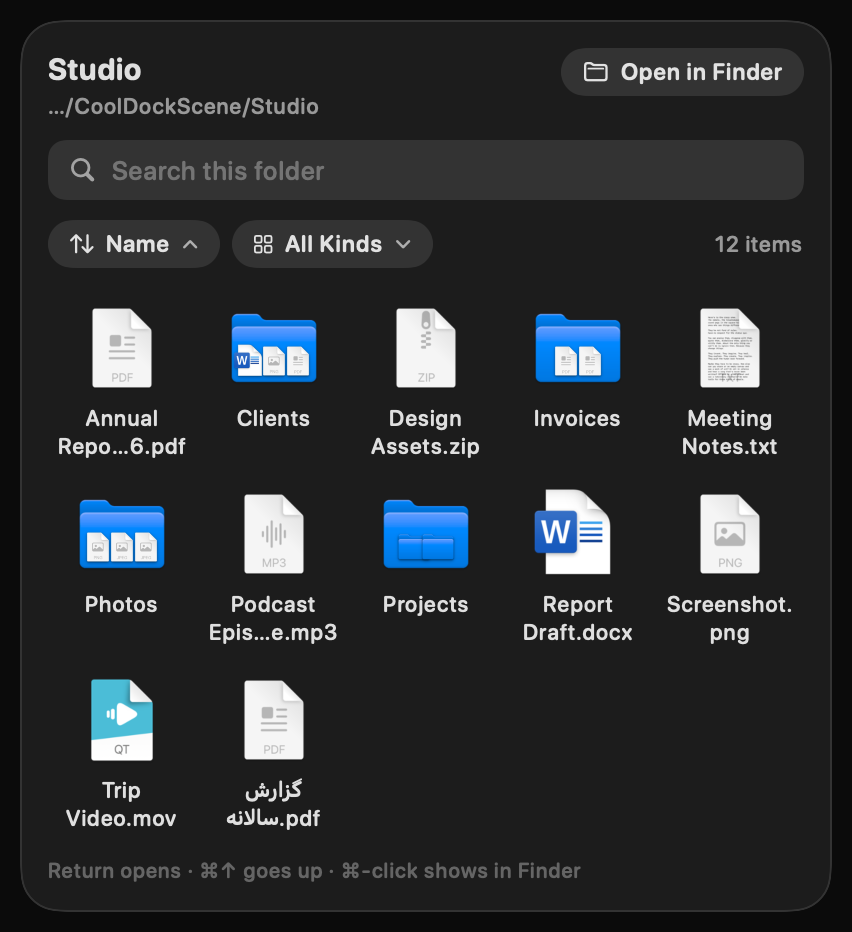 | 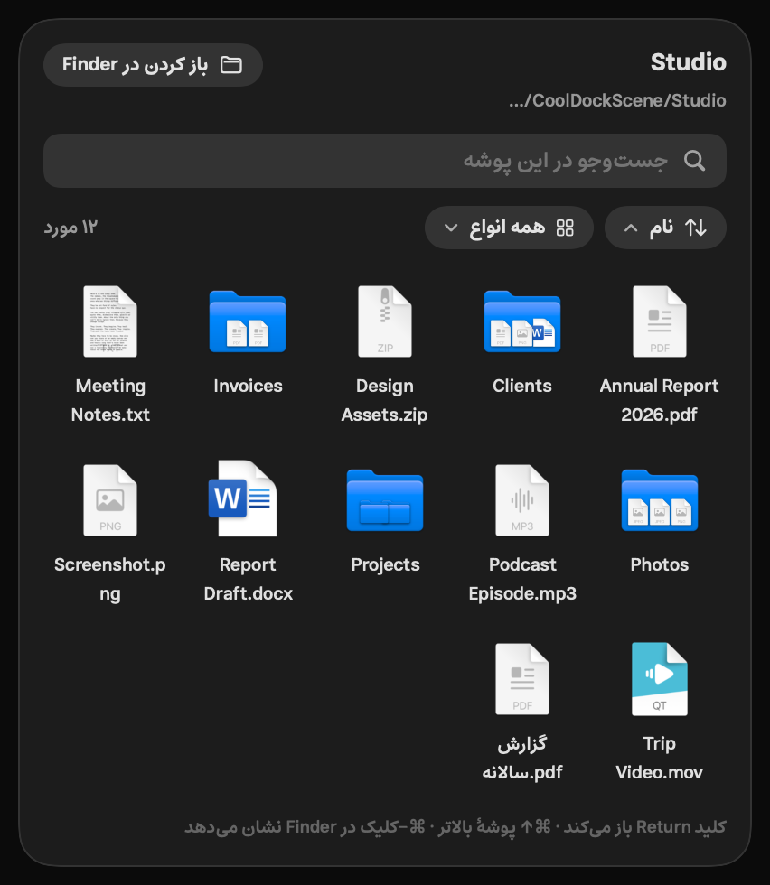 |
| Sub-folder with breadcrumbs | 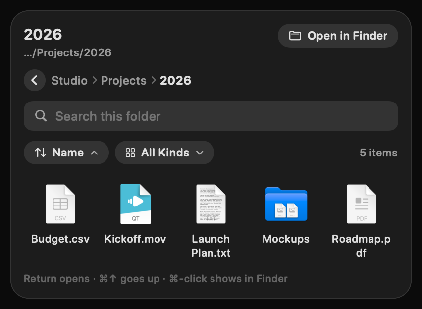 | 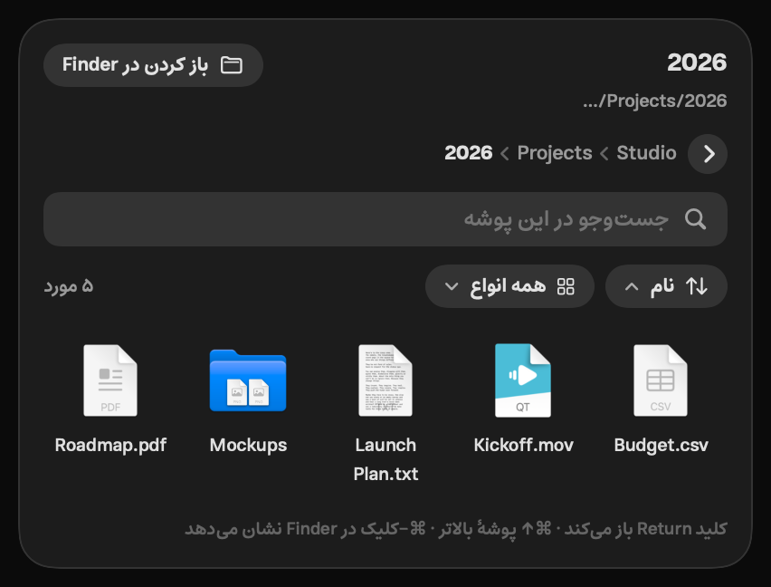 |
| Search + kind filter | 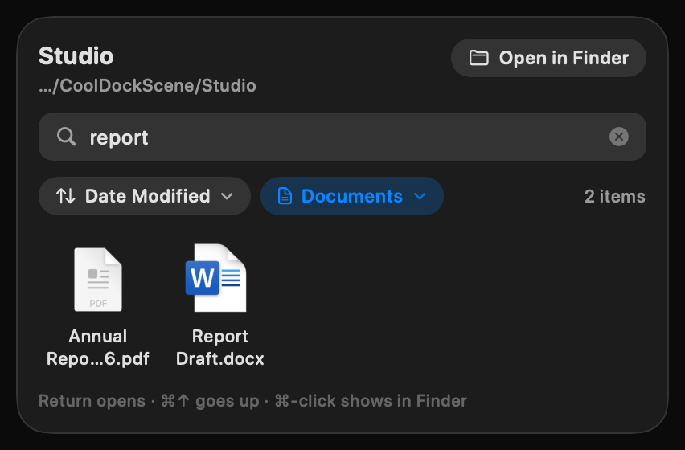 | 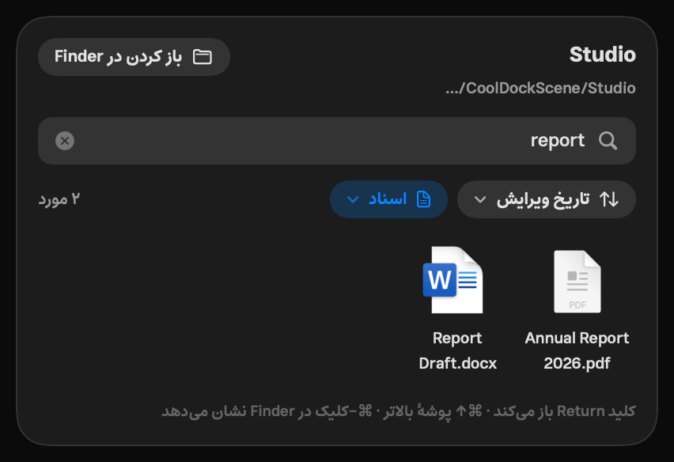 |
| Sort by size + keyboard selection | 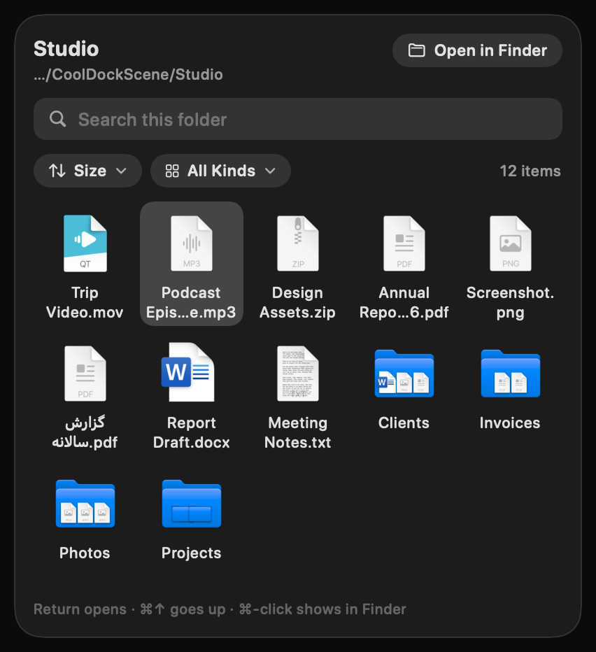 | 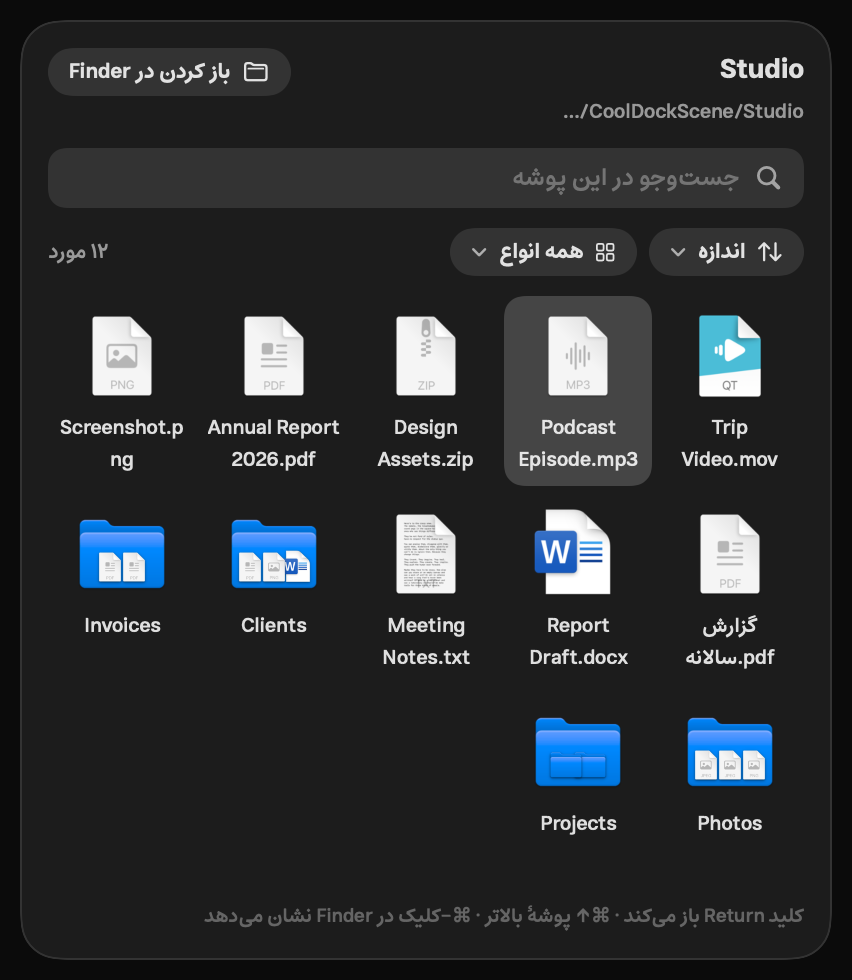 |
| Folder colours | 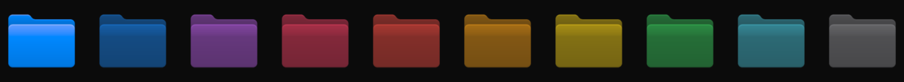 | 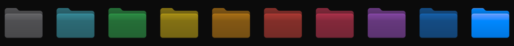 |
| Dock badges | 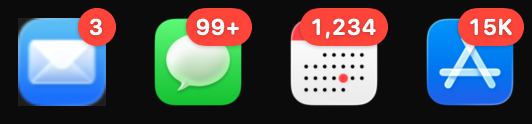 | 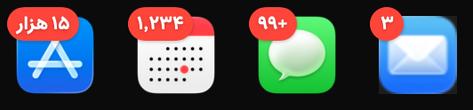 |
| App menus | 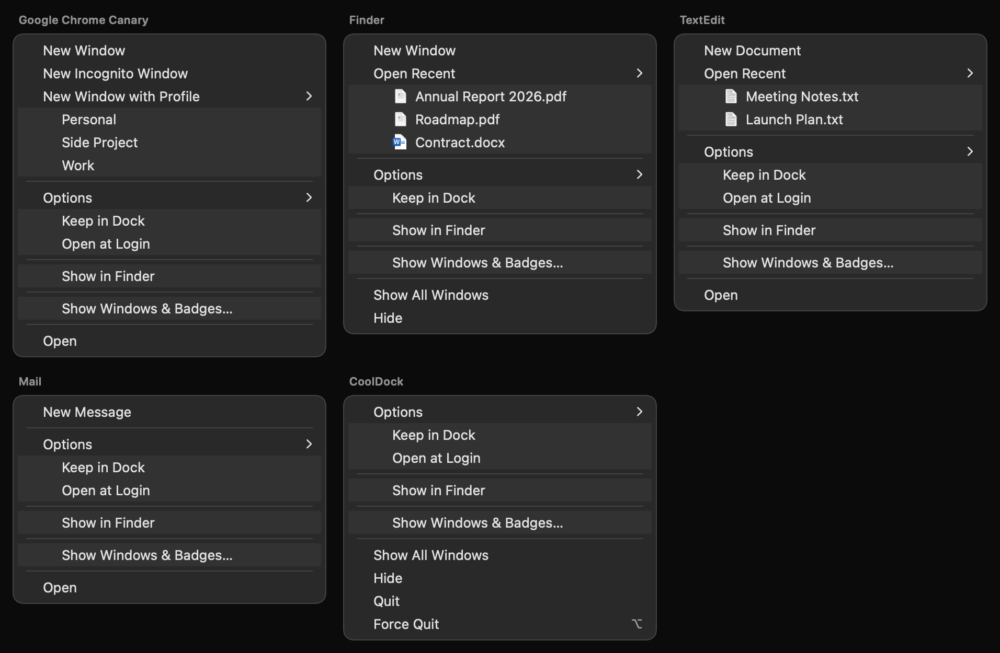 | 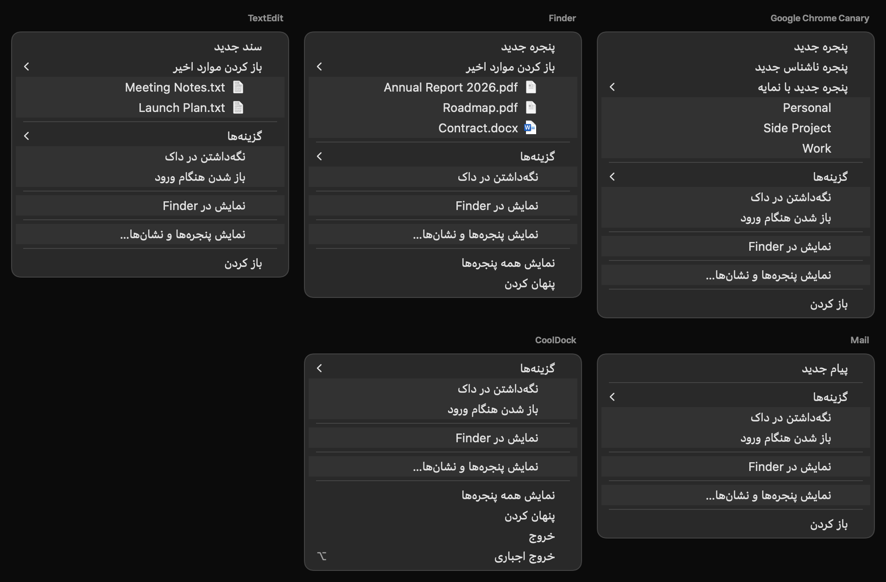 |

- **Folder window** (`folder-panel`): search field, sort chip (Name ▲), kind chip (All Kinds) and item count. Sub-folders
  preview their first items on the folder icon like Dock stacks (Clients, Invoices, Photos; Projects only holds folders).
  The Persian-named PDF sorts after the Latin names and wraps on two lines.
- **Sub-folder** (`folder-panelNested`): Studio › Projects › 2026 after drilling in. The back button and each crumb
  go back up; trails deeper than four levels fold their middle into "…" (a pop-up of the hidden levels).
- **Search + filter** (`folder-panelSearch`): "report" with Documents only, sorted by Date Modified: the two report
  files. "گزارش سالانه.pdf" ("annual report") doesn't match the Latin word, as expected.
- **Sorted** (`folder-panelSorted`): Size, biggest first; folders (no size) go last. The second cell has the keyboard
  selection (arrow keys move it, Return opens, ⌘↑ / ⌘[ / Delete go up a level).
- **Folder colours** (`folder-colors`): right-click ▸ Folder Color offers Default, Blue, Purple, Pink, Red, Orange,
  Yellow, Green, Teal, Graphite (plus Custom… → the colour picker); this is the folder icon with each tint.
- **Badges** (`app-badges`): raw labels "3", "99+", "1234", "15000" become 3, 99+, 1,234, 15K (Persian: ۳، ۹۹+، ۱٬۲۳۴، ۱۵ هزار). Live, the labels come from the Dock's accessibility tree every 2 s while an app tile is on screen.
- **App menus** (`app-menu`): the NSMenus `AppsAppMenu.build` returns, drawn as lists (submenus indented under their
  item; the harness can't draw NSMenu). Chromium: New Window, New Incognito Window, New Window with Profile ▸ in the
  browser's own profile order. Finder (running): New Window, Open Recent ▸ decoded from the `.sfl3`, Show All Windows,
  Hide, and no Quit, like the Dock. TextEdit: New Document + Open Recent. Mail: New Message. NiceDock (the running render
  process): Quit with the ⌥ alternate Force Quit. Options ▸ holds Keep in Dock / Remove from Dock, Open at Login, Show in
  Finder, and "Show Windows & Badges…" while Accessibility is off. Live menus also start with the app's window list and
  end with the tile's own items (Customize…, Widgets…, Settings…, Remove).

Persian: every new string is translated (`python3 scripts/l10n.py check` → 0 missing in all nine languages); panels and
menus mirror (back chevron, crumbs, chips and grid read right to left), and grid names get two full lines in Estedad
(its 17 pt lines need a 34 pt label instead of 28 pt, which also fixes the existing app galleries in Persian/Arabic).
The chips drop the item count, then stack, when a translation is too long for one row (checked in es, de, ru).

Pixel diff of the family's reference frames is unchanged: `scripts/pixel-diff.sh appFolder appSwitcher downloads
findFiles` → 99.51 / 99.34 / 99.94 / 99.74 % (same as before this change).
