# Calendar feeds: render evidence

Calendar widgets rendered from **real ICS feeds**, without Calendar (EventKit) access, on Tuesday 27 October 2026
around 05:40 in Asia/Tehran (the Mac's time zone). The feeds are the curl captures in `Tests/Fixtures/ics/`:

- Google Calendar "Holidays in United States" (`google-us-holidays-2026-10-27.ics`)
- the LLVM community calendar (`llvm-community-2026-10-27.ics`): Google Calendar, TZIDs and recurring meetings

Each PNG is the 2× render harness output (`<kind>.png`, no padding, dock plate background).

```bash
scripts/build-app.sh release
COOLDOCK_OFFLINE=1 COOLDOCK_ICS_FILE=$PWD/Tests/Fixtures/ics/google-us-holidays-2026-10-27.ics \
  build/CoolDock.app/Contents/MacOS/CoolDock --render out/holidays-en agenda,calendarToday,nextMeeting,weekStrip --wait 3 --lang en
# holidays-llvm-*: COOLDOCK_ICS_FILE=<holidays.ics>:<llvm-community.ics>; unconfigured-*: no COOLDOCK_ICS_FILE
```

`COOLDOCK_ICS_FILE` (colon-separated paths) is read only by the render harness (`RenderHarness.isActive`) and never
in `--scene reference`. It replaces the saved feeds and skips network and Keychain. `COOLDOCK_OFFLINE=1` keeps the
render off the network (the week strip's weather comes from the on-disk cache). The pixel-diff scene ignores feeds:
`scripts/pixel-diff.sh agenda calendarToday nextMeeting weekStrip reminders` gives the same numbers before and after this
change (98.91 / 99.26 / 99.40 / 98.88 / 98.58 % match).

## Holidays feed (`holidays-en`, `holidays-fa`)

| | English | Persian |
| --- | --- | --- |
| Agenda | 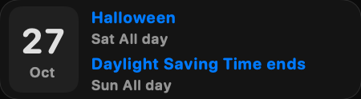 | 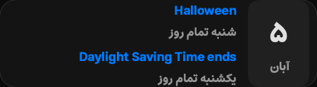 |
| Today's Events | 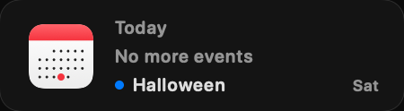 | 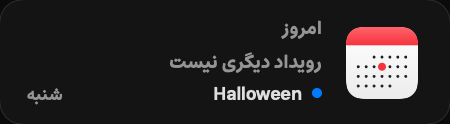 |
| Next Meeting | 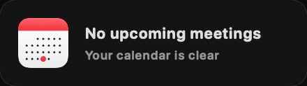 | 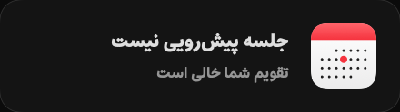 |
| Week | 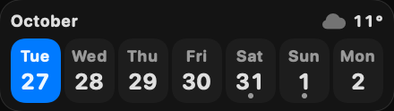 | 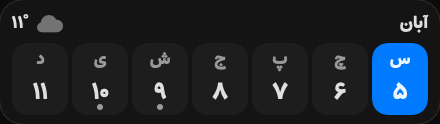 |

- **Agenda**: there is no holiday today, so it lists the next two: *Halloween* (Sat, all day) and *Daylight Saving
  Time ends* (Sun, all day). Both are `DTSTART;VALUE=DATE` events in the feed (31 Oct and 1 Nov 2026).
- **Today's Events**: "No more events", then the next one, *Halloween*, on Saturday.
- **Next Meeting**: the feed has only all-day events, so there's no meeting: "No upcoming meetings".
- **Week**: Tuesday 27 to Monday 2 November. Event dots are on Sat 31 and Sun 1. Election Day (3 November) falls
  outside the seven days.
- **Persian**: the date block shows ۵ آبان. 27 October 2026 is 5 Aban 1405 in the Solar Hijri calendar. The week starts
  at سه‌شنبه ۵ on the right, reads right to left and ends at ۱۱. The dots are under ۹ (شنبه, 31 October) and ۱۰
  (یکشنبه, 1 November). All digits are Persian. Weekday names (شنبه، یکشنبه) and "تمام روز" are localized, and the
  holiday titles stay as written in the feed. No label is clipped.

## Holidays + LLVM community calendar (`holidays-llvm-en`, `holidays-llvm-fa`)

| | English | Persian |
| --- | --- | --- |
| Agenda | 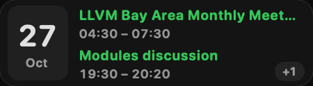 | 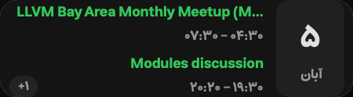 |
| Today's Events | 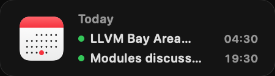 | 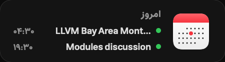 |
| Next Meeting | 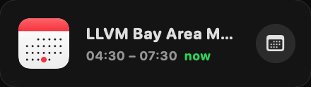 | 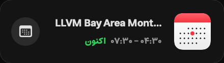 |
| Week | 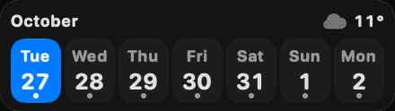 | 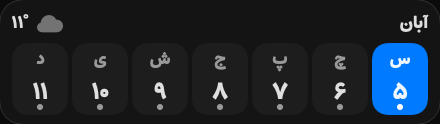 |

These are today's real LLVM events, converted to the Mac's time zone (UTC+03:30):

- *LLVM Bay Area Monthly Meetup (Mon Oct 26 ‘26 6pm)*: `DTSTART:20261027T010000Z` / `DTEND:20261027T040000Z`,
  shown as 04:30–07:30. It is in progress at render time, so Next Meeting says **now** / **اکنون**.
- *Modules discussion*: `DTSTART;TZID=America/Los_Angeles:20261027T090000`, a `RECURRENCE-ID` override of a biweekly
  series (`RRULE:FREQ=WEEKLY;INTERVAL=2;BYDAY=TU`), 50 minutes. 09:00 PDT is 16:00 UTC, shown as 19:30–20:20.
- The agenda's **+1** is the third event today: *Libc++ Monthly Meeting* at 16:30 UTC (20:00 local). The feed has it
  twice, under two UIDs from two series, and the widgets merge identical title + start into one entry. The week strip
  has a dot on every day: LLVM meetings, plus the holidays on Saturday and Sunday.
- Event titles that are too long for a tile are cut with an ellipsis, in English and Persian alike. That is how the
  widgets handle every long title. In Persian the times read start → end from the right (۰۴:۳۰ – ۰۷:۳۰,
  ۱۹:۳۰ – ۲۰:۲۰) and the "+۱" badge sits at the leading edge.

## Unconfigured (`unconfigured-en`, `unconfigured-fa`)

Without Calendar access and without feeds, the tiles offer both options. Clicking **Allow Calendar access** asks for
the permission, or opens System Settings if it was declined before. Clicking **Add calendar feed…** opens Settings →
Privacy & Permissions → Calendar Feeds, scrolled to the section with the link field focused.

| | English | Persian |
| --- | --- | --- |
| Agenda | 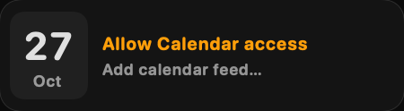 | 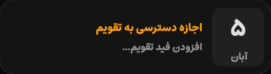 |
| Today's Events | 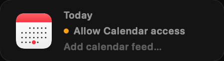 | 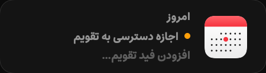 |
| Next Meeting | 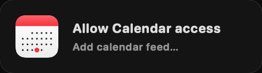 | 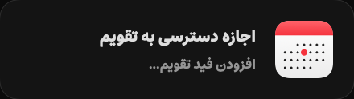 |
