# Window-aware layout and encrypted credential storage: Settings evidence

The Settings sections added for **Reserve Dock Space**, **Hide on Window Hover** and the **encrypted credential
file**, rendered offscreen in English and Persian (right-to-left, Estedad). Each PNG is a 2× render of the section at the
Settings detail width (680 pt plus margins), light appearance.

```bash
COOLDOCK_EVIDENCE_DIR=$PWD/docs/verification/system swift test --filter SystemSettingsRender
```

The test (`Tests/CoolDockTests/SystemSettingsRenderTests.swift`) only runs when `COOLDOCK_EVIDENCE_DIR` is set. It
hosts the real views (`WindowSettingsSection`, `CredentialStorageGroup` in `UI/Settings/SettingsSystem.swift`) in a
borderless offscreen window. Accessibility trust and the credential state are passed in as overrides, so every state
renders without permissions, without the Keychain and without a credential file. Persistence is off, so the user's
`state.json` is never written. The app itself is never launched.

Switches that are **on** draw in macOS's inactive grey (knob on the trailing side, filled track), because the test
process is never made the active app; activating it would take focus from whatever is on screen. **Off** switches have
a light track with the knob on the leading side. In Persian the switches are mirrored.

## Layout → Windows / Dock Space

| State | English | Persian |
| --- | --- | --- |
| No Accessibility access yet | 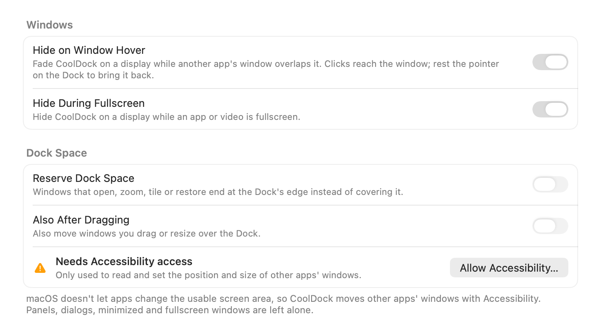 | 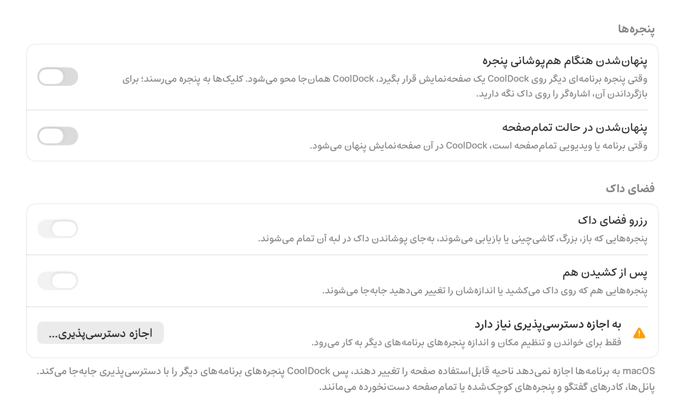 |
| Access granted, Reserve Dock Space on, All Displays | 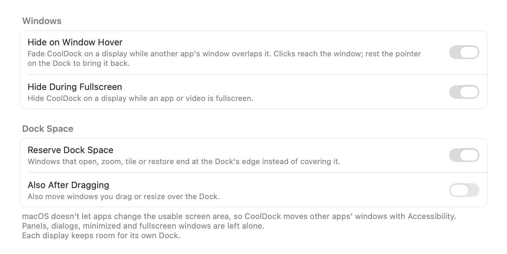 | 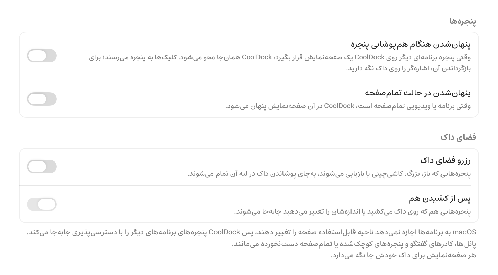 |
| Auto-hiding layout (Reveal at the Bottom) | 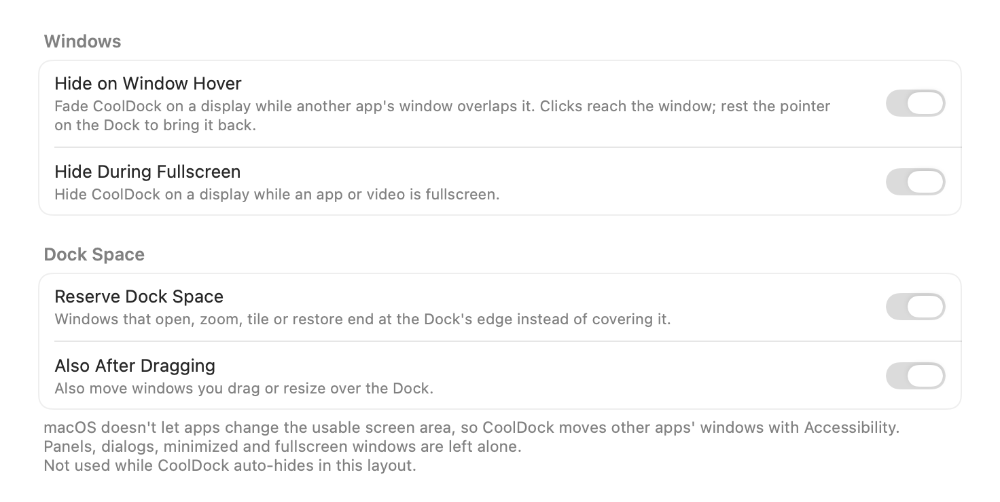 | 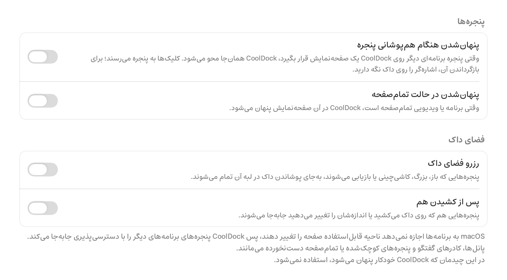 |

- **Hide on Window Hover** (on in all three) says what it now does: NiceDock fades only on the display where a window
  overlaps it, clicks reach that window, and resting the pointer on the Dock brings it back.
- **No access**: Reserve Dock Space and Also After Dragging are disabled, and an orange row explains why with the
  **Allow Accessibility…** button. NiceDock never asks on its own. The first click shows the system prompt, which also
  adds NiceDock to Privacy & Security → Accessibility. Later clicks open that list. The pane re-checks trust when the
  app becomes active and when macOS posts `com.apple.accessibility.api`.
- **Reserve on, All Displays**: Also After Dragging is enabled and off by default. The footer explains that macOS
  doesn't let apps change the usable screen area, so windows are moved through Accessibility. It also lists what is
  never touched (panels, dialogs, minimized and fullscreen windows) and adds "Each display keeps room for its own Dock".
- **Auto-hiding layout**: the footer says the option isn't used there. Like the auto-hiding macOS Dock, a hidden
  NiceDock reserves nothing.

## Privacy & Permissions → Credential Storage

| State | English | Persian |
| --- | --- | --- |
| Keychain in use (default) | 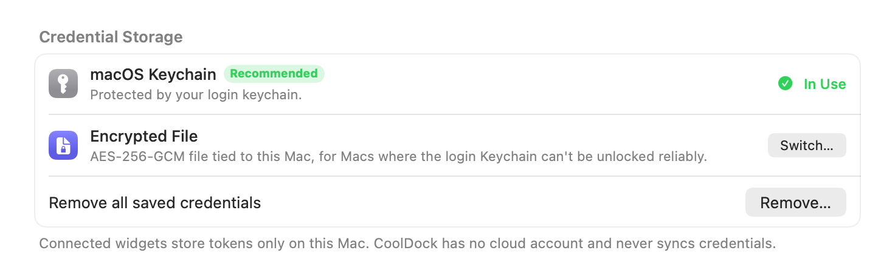 | 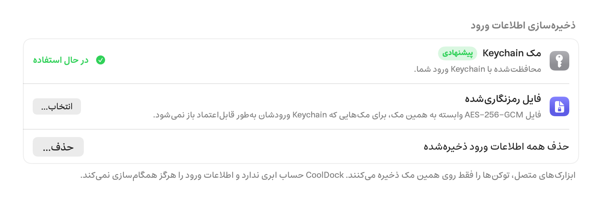 |
| Encrypted file in use, 3 credentials | 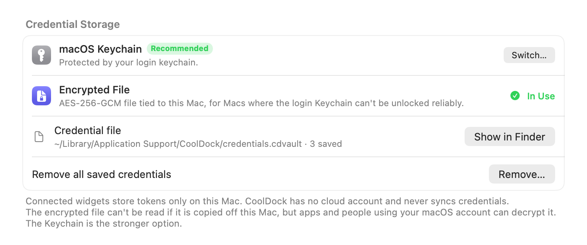 | 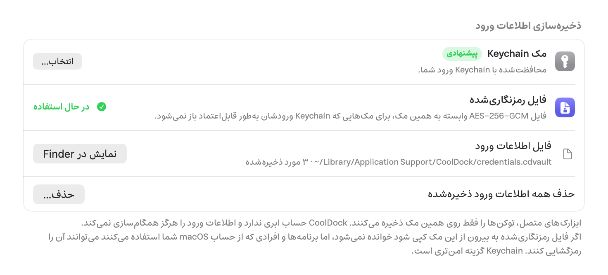 |
| Encrypted file unreadable (tampered or copied from another Mac) | 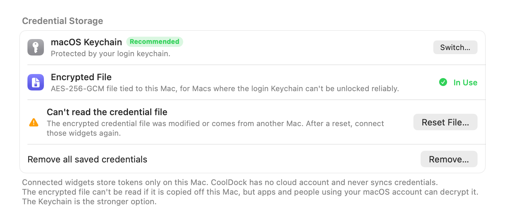 | 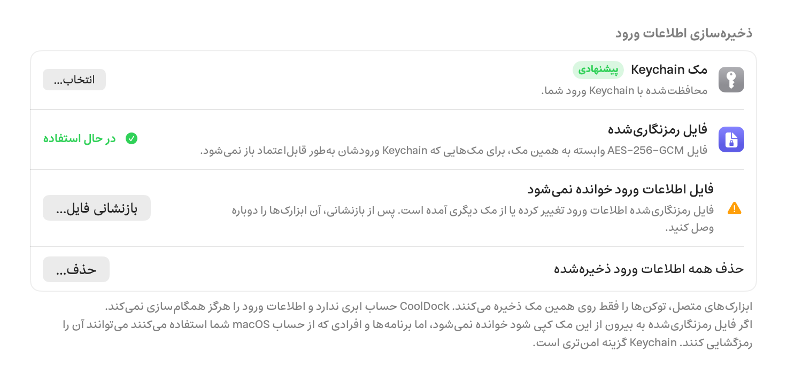 |

- The **macOS Keychain** row keeps the green *Recommended* badge. The storage that is in use shows **In Use**. The
  other row has **Switch…**, which asks for confirmation and then moves every credential (see below).
- **Encrypted file**: the file row shows the path and the number of saved credentials, with **Show in Finder**. The
  footer gives the threat model: the file can't be read once it is copied off this Mac, but apps and people using your
  macOS account can decrypt it. The Keychain is the stronger option.
- **Unreadable**: the AES-GCM tag check failed, so the row names the cause. **Reset File…** renames the unreadable file
  (`credentials.cdvault.unreadable-<time>`), keeps it, and starts a fresh store. NiceDock never overwrites a file it
  can't read.
- Persian: the path stays left-to-right inside an LTR isolate, followed by "· ۳ مورد ذخیره‌شده". Lines that begin with
  a Latin word (macOS, NiceDock, Keychain) start with an RLM so the paragraph stays right-to-left. `AES-256-GCM` is
  isolated too, so its hyphens don't reorder.

## What the unit tests cover

`swift test` (`Tests/CoolDockTests/DockSpaceTests.swift`, `CredentialStorageTests.swift`):

- **Reserve Dock Space geometry** (`ReserveSpace`): zoomed and half-tiled windows are shortened to the Dock edge. A
  partly overlapping window moves up and keeps its size. The 6 pt gap counts as overlap. Windows that already fit,
  windows beside a centred Dock, and fullscreen windows are left alone. Nothing ever goes above the menu bar. Top,
  bottom and floating Docks (nearest edge) are covered. Two displays: each display keeps room only for its own Dock,
  and a display without a NiceDock is untouched. A window spanning two displays follows the Dock it covers most. Min
  size: the window moves up before it shrinks; when the minimum height is taller than the free space, the window keeps
  its top at the menu bar and is left there. There is a floor height, and the AppKit → Quartz conversion is checked for
  a display above the primary. Applying the result twice changes nothing, so there is no loop. Drag classification:
  plain drag, tile after drag, zoom, restore and new window. The anti-fight limiter allows 3 tries per 4 s, then
  backs off for 30 s.
- **Hide on Window Hover state machine** (`HoverHideMachine`, `HoverHideBoard`): fade on overlap and show when it ends.
  The pointer must rest 0.5 s to reveal. Clicks, drags and scrolls in the area belong to the window and restart that
  wait. A revealed Dock fades again 0.4 s after the pointer leaves. An overlap that starts under a resting pointer keeps
  the Dock, while dragging a window over it fades it. Open pop-ups hold the Dock. Each display has its own state, and a
  display that disconnects is dropped.
- **Encrypted file**: round trip, including Persian text. No plaintext and no account names on disk, `0600`
  permissions, the documented envelope, a fresh nonce on every save with a stable salt, and decryption with an
  independent HKDF + AES-GCM implementation of the documented derivation. Tamper detection: flipped ciphertext, tag or
  nonce byte, an edited salt, a box swapped in from another install, an unknown version or format, a truncated file, a
  missing key file, and the same files on another Mac (different hardware UUID). An unreadable file is never
  overwritten, and quarantine keeps it.
- **Migration** with a fake Keychain (`FakeKeychain`; the real Keychain is never used, and test processes get an
  in-memory vault, which a test asserts): Keychain → file, file → Keychain (the file and key are deleted, stale
  Keychain entries are replaced), and a full round trip. Failed writes roll back and the old storage stays active.
  Unreadable Keychain items stay where they are and are reported. A tampered file shows as unreadable and can be reset.
